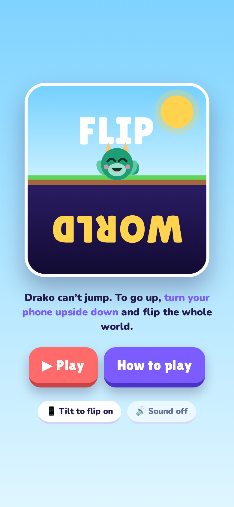
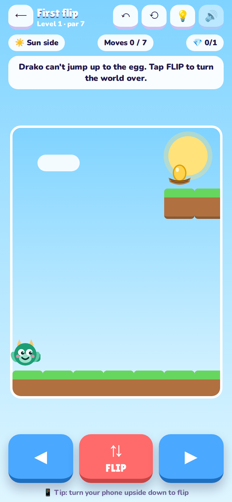
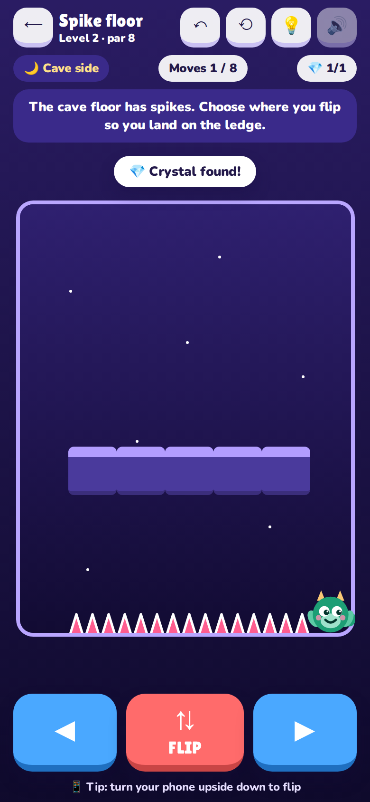
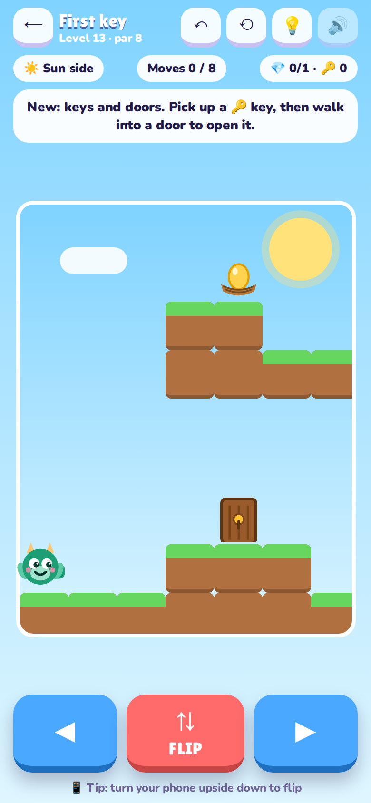
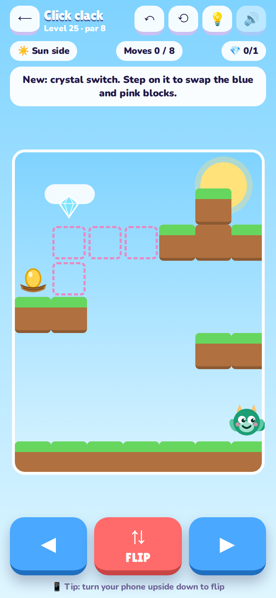
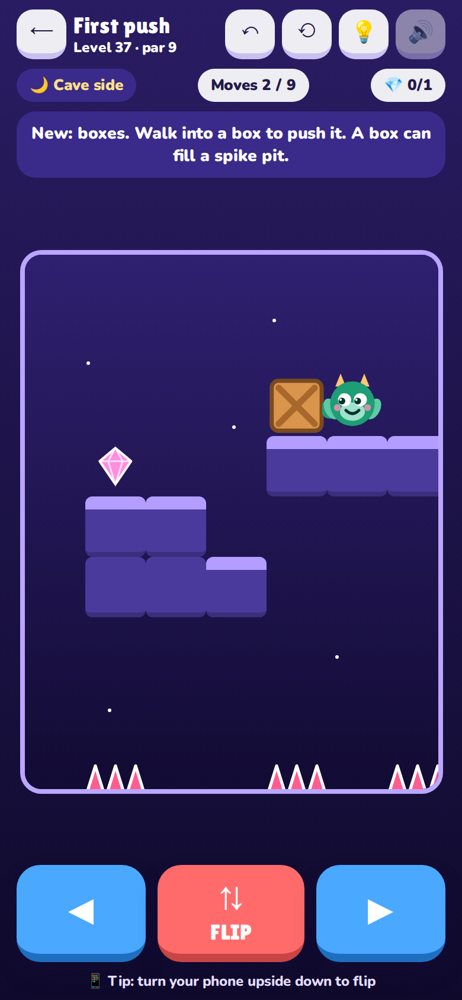
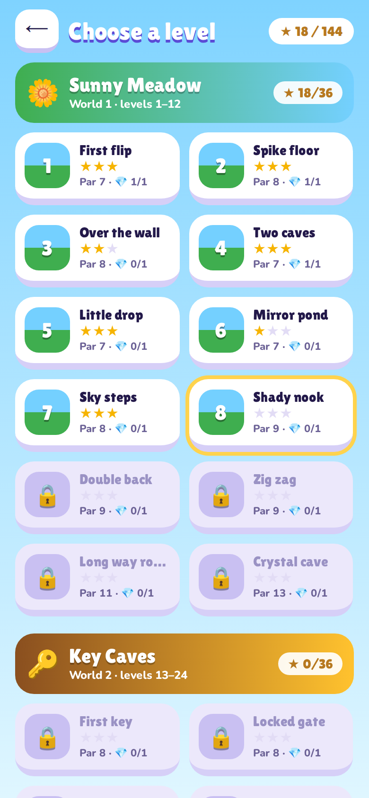
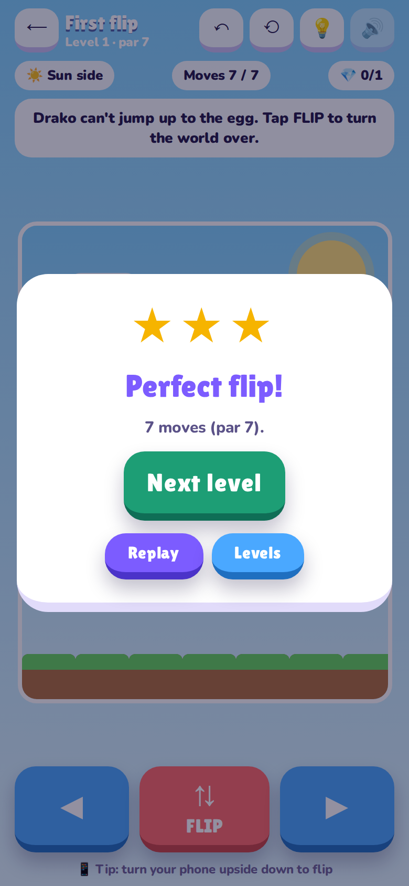

# Flip World

**Drako can't jump. To go up, turn your phone upside down and flip the whole world.**

Flip World is a puzzle game for Android and iOS, built with Expo and React Native. Every level is a board with two sides: a sunny meadow on top and a cave underneath. When you flip the board over, up becomes down, and Drako the baby dragon falls to a new place on the other side. Use both sides to reach the golden egg.

<p align="center">
  
  
  
</p>

## How to play

| Control | What it does |
|---|---|
| ◀ ▶ buttons, or swipe left and right | Drako walks one step. He can't jump. |
| Turn the phone upside down, tap **FLIP**, or swipe up or down | The board flips to its other side. Drako keeps his column, his height is mirrored, and then he falls. |
| ↶ | Undo the last move |
| ⟲ | Restart the level |
| 💡 | Hint: the button for the best next move lights up |

- Reach the golden egg 🥚 to finish a level. It can be on the sun side or the cave side.
- A flip is blocked if a block is in Drako's spot on the other side.
- Spikes send Drako back one step. There's no game over.
- Each level has a par (the fewest possible moves). Finish at par for 3 stars, within par + 4 for 2 stars, otherwise 1 star.
- Each level hides one bonus crystal 💎.

The level 1 picture above shows the idea: the egg is high up on a ledge and Drako can't jump. He walks under it, flips to the cave, then flips back. Because his height is mirrored each time, he lands right next to the egg.

### Tilt to flip

The game watches the phone's accelerometer. Each time you turn the phone from upright to upside down, or back, the world flips once. While the phone is upside down, the whole play screen turns around so it still reads the right way. You can switch tilt off on the title screen and play with the FLIP button only.

## 4 worlds, 48 levels

Each world brings in one new kind of tile, and the first level of a world explains it.

| | World | Levels | What's new |
|---|---|---|---|
| 🌼 | Sunny Meadow | 1–12 | Flipping, ledges and spike floors |
| 🔑 | Key Caves | 13–24 | **Keys and doors.** A door is solid until you walk into it while carrying a key. Opening it uses up the key. |
| 🔷 | Crystal Switch | 25–36 | **Switch blocks.** Stepping on (or falling through) the switch swaps the blocks: solid blue ones turn to glass, and glass pink ones turn solid. |
| 📦 | Box Peaks | 37–48 | **Push boxes.** Walk into a box to push it. It falls, you can stand on it, and it can fill a spike pit to make a safe floor. |

<p align="center">
  
  
  
</p>

<p align="center">
  
  
</p>

The level map shows every world with its stars, each level's par and crystal, and locks. A level opens once you've earned at least one star on the one before it. The level you should play next has a gold outline. Stars, crystals and settings are saved on the phone.

## Run it

You need **Node 24** and the **Expo Go** app on your phone. This repo has an `.nvmrc`, so run `nvm use` first. Older Node versions (such as 18) don't work with Expo SDK 58.

```bash
nvm use
npm install
npx expo start
```

Then scan the QR code with Expo Go (Android) or the Camera app (iOS).

You can also open it in a browser with `npx expo start --web`. Tilt to flip, vibration and some sounds only work on a real phone.

### Scripts

| Command | What it does |
|---|---|
| `npm test` | Runs the Jest tests, including a check that every level can be solved in exactly its par |
| `npm run typecheck` | TypeScript check |
| `npm run lint` | ESLint (Expo config with React Compiler rules) |
| `node scripts/make-sounds.mjs` | Rebuilds the sound effects in `assets/sounds` |

## How it's built

- **Expo SDK 58**, React Native 0.88, Expo Router, TypeScript, with the React Compiler on
- **react-native-reanimated** for the 3D board flip, Drako's walking and falling, and pushed boxes
- **react-native-svg** for Drako, the egg, keys, doors, crates, crystals and spikes
- **expo-sensors** (Accelerometer) for tilt to flip
- **expo-audio** for sound effects, **expo-haptics** for vibration
- **AsyncStorage** for saved progress

```
src/
  app/                 screens (Expo Router)
    index.tsx          title screen, logo, settings
    levels.tsx         level map
    play/[id].tsx      a level: board, controls, win panel, tilt
  game/
    engine.ts          the rules: moves, flips, gravity, keys, switches, boxes, and a solver
    levels.ts          the 48 levels and 4 worlds
    useFlipGame.ts     runs a level and plays the engine's events back as animations
    Board.tsx          the two-sided flipping board
    useTilt.ts         turns phone tilt into flips
    progress.ts        saved stars, crystals and settings
    sfx.ts             sounds and vibration
    TileArt.tsx        tile drawings
    __tests__/         engine and level tests
  components/          Drako, buttons, How to play
scripts/make-sounds.mjs  generates the WAV sound effects
```

### The rules engine

`src/game/engine.ts` has no React code. `step(model, state, action)` takes a move (`L`, `R` or `F`) and returns the new state plus a list of events, such as walk, flip, fall, push, key, door and switch. The play screen animates those events one by one. `solve()` is a breadth-first search over every reachable state. It powers the 💡 hint, and the tests use it to prove every level is winnable in exactly its par.

### Level format

Each level is two 7 × 9 text grids, `sun` and `cave`. The cave grid is written the way you see it after flipping. Flipping takes Drako from row `r` on one side to row `8 - r` on the other.

| Tile | Meaning | Tile | Meaning |
|---|---|---|---|
| `.` | empty | `k` | key |
| `#` | rock | `D` | door |
| `^` | spikes | `b` | crystal switch |
| `G` | golden egg | `x` | blue block (solid until the switch is hit) |
| `*` | bonus crystal | `y` | pink block (solid after the switch is hit) |
| `S` | Drako's start | `B` | box |

The bottom edge of the board always counts as floor.

## Status

- All 48 levels pass the solver test, and the type check and lint are clean.
- The title, level map and play screens have been checked in a phone-sized web preview.
- Not yet tested on a real phone: tilt to flip, vibration and sound.
- The app icon and splash image are placeholders.

There's also a web version of Flip World with the same 48 levels, made as a single HTML page.
